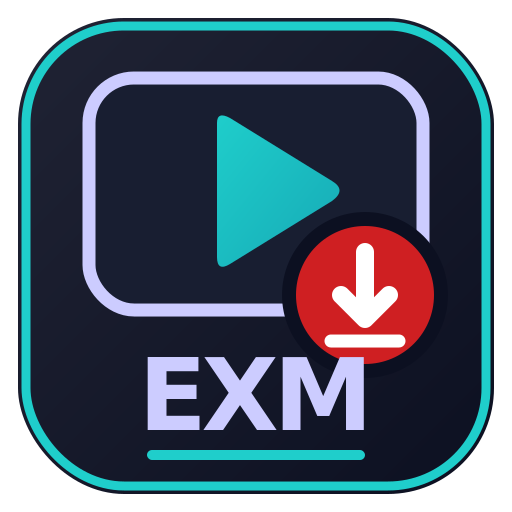

<div align="center">



# eXM Media

**A simple desktop app for downloading music, videos and thumbnails**

[](https://www.python.org/)
[](https://docs.python.org/3/library/tkinter.html)
[](https://github.com/yt-dlp/yt-dlp)
[](https://ffmpeg.org/)
[](#requirements)
[](https://github.com/DennoKush/youtube-music-downloader/commits/main)

</div>

A small desktop app for downloading music, videos and thumbnails from a URL. It is a Tkinter interface on top of [yt-dlp](https://github.com/yt-dlp/yt-dlp), with FFmpeg doing the conversion.

## Features

- **Formats:** MP3, M4A, OPUS, WAV, FLAC (audio); MP4, WEBM (video); or the thumbnail only.
- **Download modes:**
  - **Full video / playlist:** downloads the whole video, or every item in a playlist.
  - **Time range:** downloads only part of a video, from a start time to an end time (`SS`, `MM:SS` or `HH:MM:SS`). Either time can be left blank.
  - **Named chapter:** loads a video's chapter list (for example, the songs in a mix) and downloads only the chapter you pick, named after the chapter title.
- **Thumbnails:** embed them as cover art (MP3, M4A, FLAC, MP4), save them as an image file, or both.
- A progress bar and a live log of the yt-dlp output.
- Existing files are never overwritten.

## Requirements

- Python 3 with Tkinter
- `yt-dlp` and `ffmpeg` on your `PATH`

On Debian/Ubuntu:

```bash
sudo apt install python3-tk ffmpeg
pipx install yt-dlp   # or: sudo apt install yt-dlp
```

Keep yt-dlp up to date (`pipx upgrade yt-dlp`). Sites change often, and an old yt-dlp is the most common reason downloads fail.

## Running

```bash
python3 media_downloader.py
```

### Optional: desktop launcher

Create a wrapper script at `~/.local/bin/media-downloader`:

```bash
#!/usr/bin/env bash
exec python3 "$HOME/Applications/media-downloader/media_downloader.py" "$@"
```

Then make it executable and add a `~/.local/share/applications/media-downloader.desktop` entry:

```ini
[Desktop Entry]
Type=Application
Name=EXM Media
Comment=Download music, videos and thumbnails
Exec=/home/<user>/.local/bin/media-downloader
Icon=/home/<user>/Applications/media-downloader/icons/exm-media.png
Terminal=false
Categories=AudioVideo;Audio;Video;
```

## Usage

1. Paste a video or playlist URL.
2. Choose a format and a destination folder.
3. Pick a download mode. For **Named chapter**, click **Load Chapters** and select one.
4. Choose a thumbnail option and click **Download**.

Files are named `Title [video-id].ext`. Time-range downloads add the section times to the name, and chapter downloads use the chapter title.

## Files

- `media_downloader.py`: the app
- `icons/exm-media.png`: the app icon
